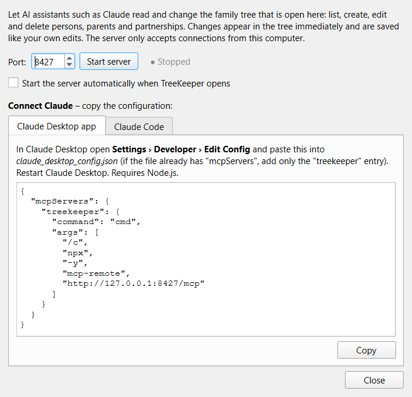

# AI access (MCP server)

TreeKeeper has a built-in [Model Context Protocol](https://modelcontextprotocol.io) (MCP) server.
When it is running, an AI assistant such as **Claude** can work on the family tree that is open in
the window. It can look people up, add and edit them, link parents and partners, and save the file.
Every change appears in the tree as it happens, just like your own edits.



- [Start the server](#start-the-server)
- [Connect Claude Desktop](#connect-claude-desktop)
- [Connect Claude Code](#connect-claude-code)
- [What the assistant can do](#what-the-assistant-can-do)
- [Privacy and safety](#privacy-and-safety)
- [Troubleshooting](#troubleshooting)

## Start the server

1. Open your family file in TreeKeeper.
2. Click the **robot** at the top right of the toolbar.
3. Keep the default port **8427**, or choose another one, then click **Start server**.

The status changes to *Running*, and the robot gets a green dot while the server is on. Tick
**Start the server automatically when TreeKeeper opens** to skip these steps next time. The server
stops when you close TreeKeeper.

The address is `http://127.0.0.1:8427/mcp`, with your port if you changed it.

## Connect Claude Desktop

Claude Desktop connects through [`mcp-remote`](https://www.npmjs.com/package/mcp-remote), so you
need [Node.js](https://nodejs.org) (`winget install OpenJS.NodeJS.LTS`).

1. In the TreeKeeper AI window, open the **Claude Desktop app** tab and click **Copy**.
2. In Claude Desktop, open **Settings › Developer › Edit Config**. This opens
   `claude_desktop_config.json`.
3. Paste the configuration. If the file already has an `"mcpServers"` section, add only the
   `"treekeeper"` entry to it:

   ```json
   {
     "mcpServers": {
       "treekeeper": {
         "command": "cmd",
         "args": ["/c", "npx", "-y", "mcp-remote", "http://127.0.0.1:8427/mcp"]
       }
     }
   }
   ```

4. Restart Claude Desktop completely: quit it from the tray icon, not just the window.

TreeKeeper must be running, with the server started, whenever you want Claude to use it.

## Connect Claude Code

Copy the command from the **Claude Code** tab, or run:

```powershell
claude mcp add --transport http treekeeper http://127.0.0.1:8427/mcp
```

Run `/mcp` inside Claude Code to check that *treekeeper* is connected.

## What the assistant can do

| Tool | What it does |
| --- | --- |
| `get_file_info` | Which file is open, how many people it has, and whether there are unsaved changes |
| `list_persons` | Find people by name |
| `get_person` | All details of one person, including parents, children and partners |
| `create_person` | Add a new person, optionally with parents |
| `update_person` | Change names, dates, places, gender, parents or notes |
| `delete_person` | Remove a person and every link to them |
| `set_partnership` | Add or change a marriage or partnership between two people |
| `remove_partnership` | Remove a partnership |
| `show_person` | Focus a person in the tree and choose the view |
| `save_file` | Save the open file |

The assistant gets the same checks as the person editor. Invalid dates, impossible relationships
and unknown people are refused, with an explanation the assistant can act on.

Some things to ask:

- *"Who are the grandparents of Lukas Keller?"*
- *"Add Maria Keller, born 14 May 1950 in Basel, as a daughter of Walter and Hedwig."*
- *"Walter and Elisabeth divorced in 1963. Please record that."*
- *"Check the tree for people who have no birth year and list them."*

## Privacy and safety

- The server only listens on `127.0.0.1`, so other computers on your network can't reach it.
  Requests from web pages, which have a foreign `Origin`, are rejected.
- It only works on the file that is open in the window, and only while TreeKeeper runs.
- Changes are written to disk only when you or the assistant **save**. If you don't like what
  happened, close the file without saving.
- The assistant sees the data of the people it looks up. Keep that in mind for living relatives.

## Troubleshooting

| Problem | Solution |
| --- | --- |
| "port … is not available" when starting | Another program, or a second TreeKeeper window, uses the port. Choose another port and copy the configuration again. |
| Claude Desktop doesn't show *treekeeper* | Check that Node.js is installed (`npx --version`), then fully restart Claude Desktop. Check the logs under **Settings › Developer**. |
| Claude says the server is not reachable | Start TreeKeeper and click **Start server** (or enable the automatic start). |
| Changes don't appear on disk | They are only in the open window until **Save**. Ask the assistant to save, or press `Ctrl+S`. |
