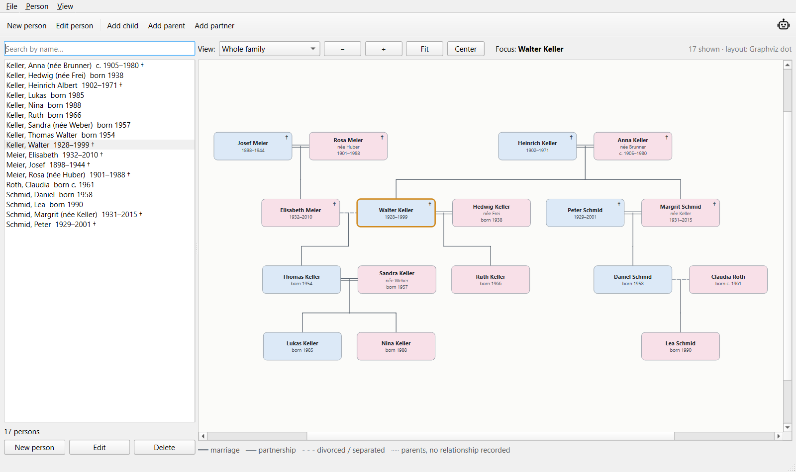
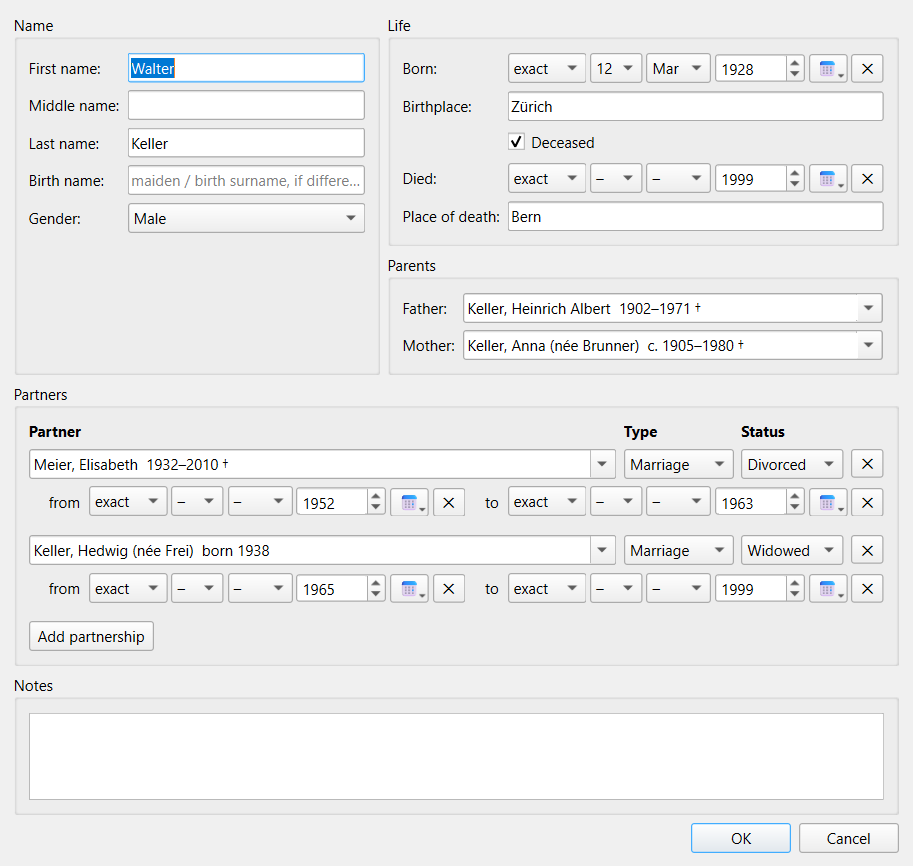
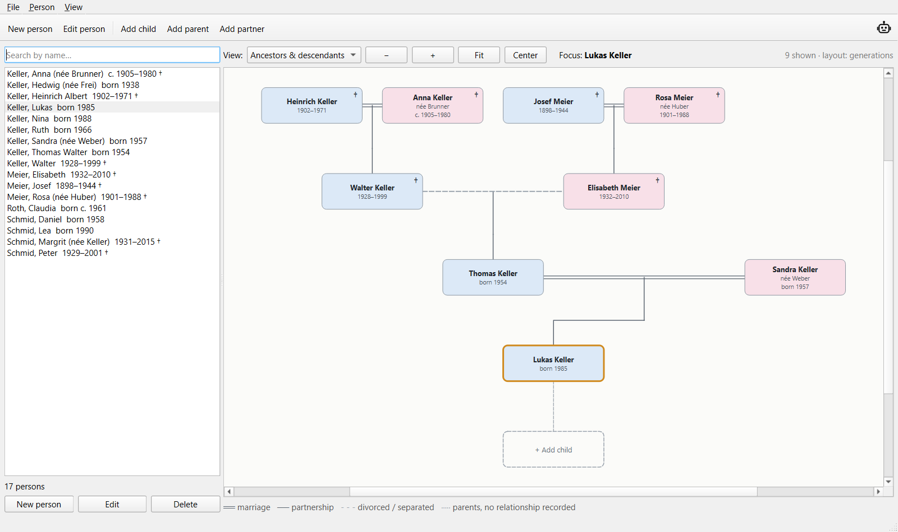

# User guide

- [The window](#the-window)
- [Files](#files)
- [Adding and editing people](#adding-and-editing-people)
- [Parents, children and partners](#parents-children-and-partners)
- [Dates](#dates)
- [The tree](#the-tree)
- [Settings](#settings)
- [Keyboard shortcuts](#keyboard-shortcuts)

## The window

| Area | What it does |
| --- | --- |
| **Toolbar** | *New person*, *Edit person*, and *Add child / parent / partner* for the focus person. The robot on the right opens [AI access](ai-access.md). |
| **Person list** (left) | Everybody in the file, sorted by name, with lifespan and † for people who have died. Type in the search box to filter. Every word must match a first, middle, last or birth name. Double-click to edit, right-click for quick actions. |
| **Tree** (right) | The family around the **focus person**, who has an orange frame. Scroll the mouse wheel to zoom and drag to move around. |
| **Controls** (above the tree) | Switch the view, zoom with − / +, *Fit* the whole tree, or *Center* on the focus person. |

## Files

A family tree is a single `.json` file. Use **File › New**, **Open…**, **Save** and **Save as…**
like in any other program. TreeKeeper reopens the last file when it starts and asks before closing
if you have unsaved changes. While there are unsaved changes, the title bar shows `*` after the file
name.

**File › Open sample data** loads a made-up family, the Kellers, Meiers and Schmids. It has
17 people over four generations, a divorce, half-siblings and an unmarried couple who separated.
Use it to try things out. Saving asks for a new file name, so the sample itself is never changed.

When a file is opened, TreeKeeper checks it and repairs broken links, such as a parent who no
longer exists. It then tells you what it fixed. See the [file format](file-format.md) for details.

## Adding and editing people

Click **New person**, or use one of the add buttons, to open the person editor:

- **Name:** first, middle and last name, plus the *birth name* (maiden name) if it differs.
- **Gender:** male, female, diverse or unknown. It sets the card colour.
- **Life:** date and place of birth and death. Tick **Deceased** if the person has died, even if
  the date is unknown.
- **Parents:** pick the **Father** and **Mother** from everybody in the file. Start typing to
  search.
- **Partners:** add one row per marriage or partnership (see below).
- **Notes:** free text, for sources, stories or anything else.

Nothing is changed until you press **OK**. **Cancel** discards everything, including people you
started to add.

To **delete** a person, select them and press **Delete** (or use the *Person* menu). TreeKeeper
asks first and says how many children will lose this parent and how many partnerships will be
removed. The children and partners themselves stay in the file.

## Parents, children and partners

**Children are not entered directly.** Someone is a child because they have a father or mother. To
add a child, use **Add child** or the dashed **+ Add child** box. The new person's parent is filled
in for you, and if the parent has exactly one (current) partner, that partner is filled in as the
other parent.

**Partnerships** are entered on either partner and appear on both automatically. Each one has:

| Field | Options |
| --- | --- |
| Type | Marriage, partnership, unknown |
| Status | Current, divorced, separated, widowed |
| From / to | Optional dates |

A person can have several partners, for example a first marriage that ended in divorce and a
second one. Half-siblings then appear under the right couple.

TreeKeeper prevents impossible relationships, such as being your own ancestor, more than two
parents, or a parent who is also a partner.

## Dates

Dates are picked, not typed:

1. Choose **exact**, **about**, **before** or **after**.
2. Pick a day and month if you know them. Both are optional.
3. Set the year, or click the calendar button to pick a full date.
4. Click **✕** to clear the date.

So `1923`, `03.1923`, `12.03.1923`, `ca. 1880`, `before 1900` and `after 1750` are all possible.
Cards show them in short form:

| Known dates | Card shows |
| --- | --- |
| Born and died | `1928–1999` |
| Born, still alive | `born 1985` |
| Only death year | `died 1944` |
| About a year | `c. 1905–1980` |

## The tree

### Views

- **Ancestors & descendants:** the focus person's parents, grandparents and so on above them, and
  their children and grandchildren below, one row per generation.
- **Whole family:** everybody connected to the focus person through parents, children or partners,
  laid out by Graphviz.

**Click** a card to make that person the focus. **Double-click** it to edit them.

### Lines

| Line | Meaning |
| --- | --- |
| Double line | Marriage |
| Single line | Partnership |
| Dashed grey | Divorced or separated |
| Dotted grey | Two parents without a recorded relationship |
| Lines from a couple down | Their shared children |

### Add boxes

Dashed boxes around the focus person create a relative in one click:

- **+ Add father / + Add mother** above the person, when that parent is missing.
- **+ Add child** below the person, after their existing children.

The boxes only open the person editor. Nothing is created unless you press **OK**, and the new
person is linked automatically.

## Settings

The **View** menu has two settings, and TreeKeeper remembers both:

- **Show "Add father/mother" boxes**
- **Show "Add child" box**

TreeKeeper also remembers the window size, the last file and the [AI access](ai-access.md) port.

## Keyboard shortcuts

| Key | Action |
| --- | --- |
| `Ctrl+N` | New file |
| `Ctrl+O` | Open file |
| `Ctrl+S` | Save |
| `Ctrl+Shift+S` | Save as |
| `Ctrl+Shift+N` | New person |
| `F2` | Edit the focus person |
| `Delete` | Delete the selected person (in the person list) |
